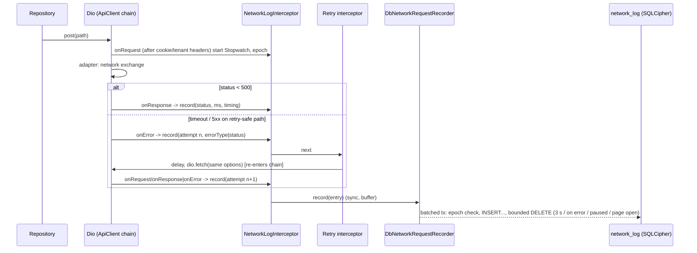
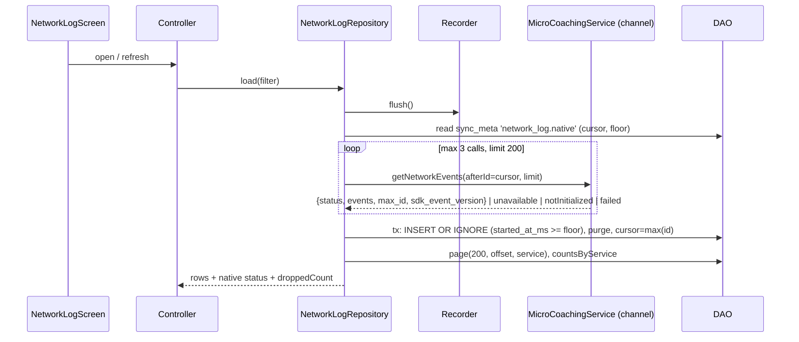
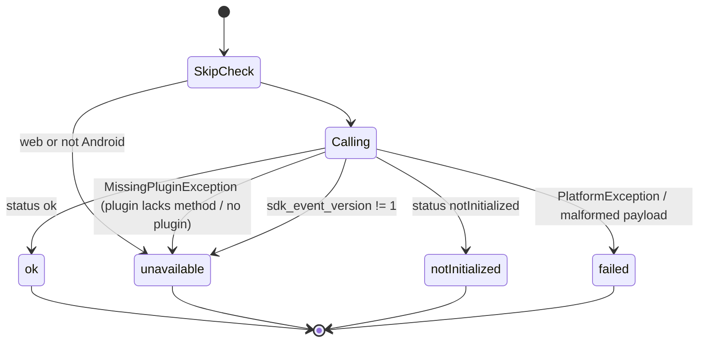

# Design: hidden "Network" diagnostics page and request log, app side (uhis_lf_mobile#778, parent leapwell#14)

Worktree checked: `/Users/amresh/labs/leapwell/repos/uhis_lf_mobile-778` @ `1f9fcbf9` (origin/develop). shukhee_sdk resolved at `dd9742c6` (this is the current `main`, checked with `git ls-remote`), read from `~/.pub-cache/git/shukhee_sdk-dd9742c6…/`. Dio 5.11.1, go_router 14.8.1, web_socket_channel 3.0.3. These come from the main checkout's `.dart_tool/package_config.json`. `pubspec.lock` is not tracked. I read no env files or secrets.

---

## 1. Intent and why
Support staff, QA and developers cannot see from inside an installed build which full URL each request used, which service it reached, its status or how long it took. The recent `/admin-api` 404 could only be found from a laptop. This feature adds a hidden page, available in release builds, that shows:
- the base URL each service resolves to, and the rule that produced it;
- a local, capped, sanitised log of every real request made by Dart, plus the native coaching SDK's requests, which the app pulls from the SDK.

## 2. Goals
- G1. Every Dart HTTP request gets one row per attempt: method, sanitised URL, status (or error type) and duration. This includes 4xx, 5xx, timeouts and offline failures. The WebSocket handshake is logged too.
- G2. Native SDK events are merged when the page is opened or refreshed. If the SDK is missing, too old or not initialised, the page says "native capture unavailable" and nothing throws.
- G3. Nothing sensitive is stored: no headers, bodies, tokens, cookies or presigned signatures. Path identifiers are masked by the shared rule.
- G4. The table is capped at the newest 2,000 rows and wiped on user switch only. Writes are batched, and a request never waits on the DB.
- G5. The page opens after 10 quick taps on the Offline Sync header and on the login logo. It works before and after login, and offline.
- G6. A test fails when a new transport is added without being registered for logging.

## 3. Non-goals and anti-goals
- No upload or export beyond copying at most 200 sanitised rows to the clipboard. No remote toggle and no PIN (owner decision).
- We do not capture these: the Shukhee call WebView (`shukhee_call_view.dart:72`, `loadRequest`), `url_launcher` hand-offs, Firebase Analytics, ML Kit and Play Core (all native, outside the coaching SDK), and Google Fonts (runtime fetching is off, `main.dart:136`).
- We do not refactor clients into one Dio factory (approach B) and do not add an `HttpOverrides` wrapper (approach C).
- We do not fix the existing debug loggers that print tokens: `LogInterceptor(requestHeader: true)` at `api_client.dart:248-259` and `[ShukheeDebug]` printing `options.headers` at `shukhee_client_factory.dart:84-88`. They need a separate ticket. Our interceptor must never read headers, and a test checks this.
- We do not clear the log on ordinary logout (decision 3).

## 4. Constraints
- Engineering Design Standards (leapwell `CLAUDE.md`): layered code (screen → controller → repository/DAO), no hardcoded copy (`app_strings.dart` plus `assets/translations/strings.json`), narrow catches, config only through `AppConfig`.
- Repo rules (`repos/uhis_lf_mobile-778/CLAUDE.md:469-473`): no raw HTTP in screens, and new behaviour ships with a test.
- Verify commands (`repos.json`): `flutter test`, `flutter analyze`, `flutter build apk --debug`.
- No background isolates use Dio today (searched for Workmanager, `Isolate.spawn` and `compute`; only CDSS `compute` methods exist). One recorder per process is enough.

## 5. Approaches considered
- **A (chosen): one idempotent `NetworkLogInterceptor`, attached at each Dio site, plus a registry test.** It is the smallest change, keeps each client's own timeouts and auth, and the registry test turns "forgot to attach" into a red build.
- **B (rejected): central Dio factory refactor.** It would touch 17 construction sites and their timeout/auth semantics (AI clients differ, e.g. `card_extraction_transport.dart:76`, which uses a 180 s timeout). It is a large regression surface for a diagnostics feature, and SDK-built Dios (shukhee) still need injection anyway.
- **C (rejected): `HttpOverrides` / `HttpClient` wrapper.** It sits below Dio, so it cannot see Dio retries as attempts, `validateStatus`, or error types. It does nothing on web (`BrowserHttpClientAdapter`, `browser_adapter_web.dart:5`). It also sees raw URLs and headers at the lowest layer, which is a bigger privacy surface.

## 6. Decisions (owner, recorded and not reopened)
1. **Capture:** approach A, plus a registry test that fails on an unregistered `Dio(` or non-Dio transport.
2. **Availability:** always on in release. Trigger is 10 taps, each within 2 s of the previous, `HitTestBehavior.opaque`, on `Text(OfflineSyncStrings.title)` (`offline_sync_screen.dart:121-127`) and on the logo `SvgPicture.asset('assets/images/leapwell-icon-foreground.svg')` (`login_screen.dart:251-259`). Reachable before and after login.
3. **Clearing:** only on user switch, i.e. when `AppDatabase.wipeAllData()` runs (only caller: `offline_sync_service.dart:326-328`). Ordinary logout keeps the local DB for UHIS parity (`auth_state.dart:471`, comment at `:489`). **This replaces the AC "cleared on logout" in #14 and #778; the issue text still says logout and needs a human edit (decision D2).**
4. **Storage:** table `network_log` in the SQLCipher DB, schema 59 → 60 (`app_database.dart:27`). DDL goes in `createSchema` and in `onUpgrade` under `if (from < 60)`. The newest 2,000 rows are kept, inserts are batched and transactional with a bounded purge, and the table is added to `_allTables`. No headers, bodies or tokens.
5. **One URL sanitisation rule** shared with the Kotlin SDK through JSON test vectors:
   - mask email, phone, UUID and 6+ digit-run path segments as `{id}`;
   - keep only allowlisted query keys, with value `<redacted>`;
   - drop userinfo and fragment;
   - cap at 2,048 chars;
   - a malformed URL becomes `<unparsable>`.
6. **Native SDK uses a pull model:** MethodChannel `com.medtroniclabs.uhis_next/micro_coaching`, method `getNetworkEvents(afterId)`. Results are merged with `source=native` and de-duplicated by `native_id`. Status is one of `ok | unavailable | notInitialized | failed`. Only `MissingPluginException` and `PlatformException` are caught. The call is skipped on platforms other than Android. It follows the existing `isInitialized` pattern (`micro_coaching_service.dart:54-58`).
7. **Strings and page:**
   - Strings live in `NetworkLogStrings` in `app_strings.dart`, with keys in `assets/translations/strings.json` (not the baseline file).
   - The page has "Configured endpoints" (every AppConfig base URL plus the SDK base URL, each with its rule) and a paginated "Request log": 200 per page, `ListView.builder`, `SelectionArea`, service filter chips, refresh, clear, and copy of at most 200 rows.

---

## 7. Design

### 7a. Transport inventory (verified)

**Classification key**
- **C1** = covered by the `ApiClient.create()` chain (`api_client.dart:88-261`).
- **C2** = covered by `attachAiServiceAuth` (`api_client.dart:347-377`), which will also attach the log.
- **OWN** = needs its own attach.
- **WS** = WebSocket seam.
- **N/A** = not capturable or makes no request.

| # | Site | What it is | Class | Notes |
|---|---|---|---|---|
| 1 | `lib/core/api/api_client.dart:90` | main Dio | C1 | `validateStatus: s < 500` (`:98`), so 4xx arrive in `onResponse`. Retries replay with `dio.fetch(options)` (`:241`). Debug `LogInterceptor` at `:248-259` uses `requestHeader: true` (`:252`) and prints `Authorization`. |
| 2 | `api_client.dart:109` | `HttpClient()` adapter (debug cert bypass) | N/A | This is Dio #1's adapter. Covered by #1. |
| 3 | `lib/core/api/frappe_client.dart:59` | `FrappeClient` default Dio; built by `buildFrappeAiClient` (`:175`); used at `main.dart:743` and `visit_flow_screen.dart:1764` | OWN | `getBytes` uses `ResponseType.bytes` with `validateStatus` allowing 2xx and 304 (`:94-125`), so 4xx and 5xx arrive as `badResponse` errors. |
| 4 | `lib/core/api/scribe_api_service.dart:262` | Scribe Dio, own auth interceptor | OWN | `validateStatus < 500` (`:267`). Has `api`, so it can call `api.attachNetworkLog(_dio)`. |
| 5 | `lib/core/auth/user_hierarchy_service.dart:648` | feature flags `tempDio`, unauthenticated, AI host | OWN | Has `_api`. |
| 6 | `user_hierarchy_service.dart:680` | Shukhee kill-switch `tempDio`, `/admin-api` | OWN | This is the known 404 (`:670-672` doc). |
| 7 | `lib/core/sync/call_log_sync_client.dart:84` | constructed at `main.dart:223` | OWN | |
| 8 | `lib/core/sync/shukhee_encounter_link_client.dart:24` | constructed at `main.dart:245` | OWN | |
| 9-12 | `telemetry_uploader.dart:44`, `assistant_content_uploader.dart:24`, `value_audit_uploader.dart:32`, `visit_content_uploader.dart:25` | direct AI Dios (only when `AI_SERVICE_URL` is set; otherwise they use `_client.dio`, which is C1) | C2 | |
| 13 | `lib/core/version/app_version_service.dart:269` | app-version check, runs pre-login | C2 / C1 | |
| 14 | `lib/features/assistant/assistant_repository.dart:29` | assistant direct Dio | C2 | |
| 15 | `assistant_repository.dart:62` | coaching RAG Dio | OWN | `validateStatus < 500` (`:66`). |
| 16 | `lib/features/visit/briefing/visit_briefing_repository.dart:42` | briefing direct Dio | C2 | |
| 17 | `lib/features/visit/immunisation/card_extraction_transport.dart:76` | card OCR direct Dio | C2 | |
| 18 | `lib/features/teleconsult/shukhee_client_factory.dart:56,64` | Dio injected into `ShukheeClient`, **debug only today** (`dio: kDebugMode ? … : null`) | OWN (inject in release) | See the shukhee_sdk finding below. |
| 19 | `lib/features/teleconsult/shukhee_consent_client.dart:123` | built by `buildShukheeConsentClient` (`:18-31`) | OWN | |
| 20 | `lib/features/realtime_asr/realtime_asr_channel_io.dart:20` | `IOWebSocketChannel.connect`. Its URI comes from `realtime_asr_service.dart:52-77`, and the query carries `encounterId` and `tenantId`. Called from `realtime_asr_controller.dart:446`. | WS | `HttpClient()` at `:17` is the debug WS client (covered). The web stub throws (`realtime_asr_channel_web.dart:8`). |
| 21 | `lib/features/visit/eval/eval_fhir_uploader.dart:18` | `package:http` import only, for `http.ClientException`. `_uploadEntry` is disabled and makes no request (`:41-46`). | N/A (inert) | Registry marks it inert and fails if an `http.get/post/Client(` call appears. |
| 22 | shukhee_sdk `lib/src/shukhee_call_view.dart:72` | WebView `loadRequest` | N/A | Non-goal. |
| 23 | `url_launcher` call sites (e.g. `counselling_launcher.dart:26`, `app_update_flow.dart:139`) | hand-off to other apps | N/A | Non-goal. |
| 24 | Native coaching SDK (OkHttp) | handled through the pull contract (section 8) | native | |

`lib/core/errors/domain_exceptions.dart:80,92` (`_fromDio(`) is not a construction; the `\bDio\s*\(` regex does not match it. `plugins/flutter_tesseract_ocr` and `third_party/sqlite` contain no transports.

**shukhee_sdk finding (dd9742c6).**
- `ShukheeClient(this._config, {Dio? dio})` uses `_dio = dio ?? Dio(BaseOptions(...))` (`lib/src/shukhee_client.dart:23-31`).
- All five HTTP calls go through `_dio.post`: `getSpecialities :44`, `startConsultation :158`, `pollStatus :212` (looped), `getPrescription :249`, `downloadDocument :287`.
- So when a Dio is injected, every SDK HTTP request is logged.
- Consent is not in the SDK. It is the app's own `ShukheeConsentClient` (#19), and `get_controls` is #6.
- What cannot be logged is the call WebView (#22).
- **Caveats:**
  - The `dio` parameter is documented as "exposed only so tests can inject a fake transport — real callers should never pass it" (`:21-22`). We would rely on a test seam in release. The app already does this in debug.
  - The dependency is unpinned: `ref: main` in `pubspec.yaml:55-58`, and the lock file is not tracked. A future SDK change that builds a second Dio would bypass logging silently.
  - Mitigations: tasks T6c and T6d below, and decision D3 (pin plus an SDK issue).
- Query key used by the SDK: `_lang` (`:327-330`). Auth uses the `X-Auth-Token` header, which we never read.

### 7b. Interceptor placement and order (ApiClient.create)

Dio 5.11.1 runs request, response **and** error interceptors in the same FIFO order (`dio_mixin.dart:527-583`). The current `ApiClient.create()` order is:
1. ImplyContentType (Dio default)
2. cookie/Bearer request and auth-response interceptor (`:136-193`; web variant `:121-134`)
3. tenant / app-version headers (`:195-218`)
4. retry (`:221-247`)
5. debug `LogInterceptor` (`:248-259`)

**Insert `NetworkLogInterceptor` between 3 and 4**, i.e. a single `NetworkLogInterceptor.attach(dio, recorder)` call at line 219, before the retry `add`. Reasons:
- **`onRequest`** runs after the async cookie and header work, so the Stopwatch measures the network exchange plus response transform, not cookie-jar I/O.
- **`onError`** runs **before** the retry interceptor. Attempt *n*'s failure is recorded as its own row before the retry delay (`AppConfig.apiRetryDelaySeconds`, `:234`), so the delay is not counted in any row.
- The replay `dio.fetch(options)` (`:241`) re-enters the whole chain. Our `onRequest` restarts the Stopwatch and the replayed attempt records its own row.
- If the interceptor sat after the retry interceptor, attempt 1 would never be logged. The outer `handler.next(retryError)` (`:243`) would then also produce a duplicate row for the last attempt. A test asserts exactly N rows for N attempts (T5).
- The retry interceptor mutates and reuses the **same** `RequestOptions` (`:238-239`). Our Stopwatch key in `options.extra` is simply overwritten per attempt, which is correct because the previous attempt has already been recorded.
- Attempt number: read the `uhisAttempt` extra (`_kAttemptKey`, `:19`). Move that constant to a small shared file (e.g. `lib/core/api/request_extras.dart`) so `net_log` does not import `api_client.dart`. Builder's call.
- 401 and 403: `_onAuthResponse` always calls `handler.next` (`:268-293`), so our `onResponse` sees 401 and 403 rows.

**Other Dios.** `attach()` appends, so it is last and closest to the network. These Dios have no retry interceptor, so order is otherwise irrelevant. `attachAiServiceAuth` attaches the log after its auth interceptor.

**Idempotency.** `attach` is a no-op when `dio.interceptors.any((i) => i is NetworkLogInterceptor)`.

**Recorded fields per callback**
- `onRequest`: put `Stopwatch()..start()` under `extra['netLogSw']`. Also record `epoch = recorder.epoch` (see 7d).
- `onResponse`: `statusCode`, `duration = sw.elapsedMilliseconds`, `error_type = null`.
- `onError`:
  - `statusCode = e.response?.statusCode`;
  - `error_type = e.type.name` (e.g. `connectionTimeout`, `connectionError`, `receiveTimeout`, `sendTimeout`, `badCertificate`, `cancel`, `unknown`), except that `badResponse` with a response stores `null`, because the status code tells the story;
  - enum `.name` strings survive obfuscation, but `runtimeType` strings do not and are never used.
- **No stopwatch in `extra`:** the request was rejected by an earlier interceptor before reaching ours, so it never hit the network. It is not recorded. Builder's call; document it in the class doc.
- **Redirects:** `dart:io` follows GET/HEAD redirects inside the adapter (default `followRedirects = true`, `maxRedirects = 5`, `options.dart:730-731`), so interceptors see one exchange. Record the requested `options.uri`. When `response.redirects.isNotEmpty`, also store the sanitised `response.realUri` in `final_url`. Recommended, because "which URL was actually used" is the debugging goal.
- **Timing label (`timing` column):**
  - `total` for `json`, `plain` and `bytes`. Dio buffers and transforms inside dispatch before `onResponse`, which covers `frappe_client.dart:105` and `offline_sync_service.dart:689`.
  - `headers` when `options.responseType == ResponseType.stream`, because `onResponse` fires at headers. There are no stream users in `lib/` today; the rule is generic.
  - `handshake` for WebSocket rows.
  - Native rows are always `headers` (section 8).
- The interceptor never reads `options.headers`, `data`, `response.data` or `e.message`.

### 7c. Components (all new code in `lib/core/net_log/` unless noted)

| Component | Responsibility |
|---|---|
| `UrlSanitizer` (pure, total, never throws) | The shared rule (7f). |
| `ServiceClassifier` (pure; takes `List<ConfiguredEndpoint>`) | Labels a URL in this order: (1) longest base-URL prefix match against the resolved endpoints, e.g. a direct `AI_SERVICE_URL` maps to `ai-scribe`; (2) on the `API_BASE_URL` host, the first path segment (`auth-service`, `user-service`, `spice-service`, `offline-service`, `fhir-server`, `ai-scribe`, `micro-coaching`, `admin-api`); (3) any other host gives `other-host` (presigned storage URLs land here); (4) otherwise `other`. The endpoint list also carries one extra row, service `api-gateway` (the configured `API_BASE_URL` itself, `ServiceClassifier.gatewayService`), which supplies the API host for step 2; `classify` never returns it, and the page lists it like any other endpoint. |
| `NetworkLogEntry` (value class) | `startedAtMs, source, nativeId?, service, method, url, finalUrl?, statusCode?, durationMs?, timing, attempt, errorType?, epoch`. |
| `NetworkRequestRecorder` (interface) | `int get epoch; void record(NetworkLogEntry e)`. Synchronous; never awaits; never throws. |
| `NoopNetworkRequestRecorder` | Default for `ApiClient.create()`, so the many existing tests need no change. |
| `DbNetworkRequestRecorder` (implements the recorder and `WipeParticipant`) | In-memory buffer capped at 500 (on overflow the oldest is dropped and `droppedCount++`). A one-shot 3 s timer is armed only when the buffer is non-empty, so there are no idle wakeups. It flushes immediately (microtask-coalesced) on status ≥ 400 or an error, flushes on `flush()` from the lifecycle `paused` hook and on page open, and catches only `DatabaseException` (`droppedCount += n`). Exposes `clearBuffer()` and `droppedCount`. |
| `NetworkLogInterceptor` | See 7b. `static void attach(Dio, NetworkRequestRecorder)`. |
| `NetworkLogDao` (template `lib/core/telemetry/telemetry_dao.dart`) | `insertBatch`, `mergeNative`, `page({limit, offset, service})`, `countsByService`, `newest(limit)`, `clear`, plus the native cursor read/write through `SyncMetaDao` (`sync_meta_dao.dart:31,48`). |
| `NativeNetworkEventSource` (interface) and `MicroCoachingNetworkEventSource` | The latter wraps a new `MicroCoachingService.getNetworkEvents`. |
| `NetworkLogRepository` | Flush Dart buffer, pull and merge native rows, then read a page. |
| `lib/features/debug/network_log_screen.dart` and `network_log_controller.dart` | Page plus `ChangeNotifier` controller. Widgets hold no logic. |
| `lib/core/widgets/hidden_tap_trigger.dart` | `HiddenTapTrigger({required int taps = 10, Duration window = 2s, required VoidCallback onTriggered, required Widget child})`. Uses `GestureDetector(behavior: HitTestBehavior.opaque, onTap: …)`. |
| `AppConfig.configuredEndpoints` (`app_config.dart`) | One home for the URL and its rule. Each getter is refactored to a private resolver returning `(url, rule)`; the existing getter returns `.url`. Covers `apiBaseUrl` (`:31`), `coachingServiceUrl` (`:114-117`, `COACHING_SERVICE_URL` or `API_BASE_URL + /micro-coaching`), `aiServiceBaseUrl` (`:140`), `scribeBaseUrl` (`:152-157`), `assistantBaseUrl` (`:161-164`), `shukheeApiBaseUrl` / `spiceNextCoreApiBaseUrl` / `spiceNextAiApiBaseUrl` (`:446-484`, all `API_BASE_URL + /admin-api` by default via `_shukheeGatewaySegment` `:417`). Rule text such as `API_BASE_URL + /admin-api` is a config identifier, not user copy. Only URL getters are listed, never `hfToken`. |
| `MicroCoachingService.sdkBaseUrl(String)` | Make `_sdkUrl` (`micro_coaching_service.dart:12-16`) public so the page shows the URL the SDK actually uses. |

**Wiring**
- `ApiClient`:
  - `create({NetworkRequestRecorder networkRecorder = const NoopNetworkRequestRecorder()})`;
  - `NetworkRequestRecorder get networkRecorder`;
  - `void attachNetworkLog(Dio dio)`;
  - `attachAiServiceAuth` also calls `attachNetworkLog(direct)`.
  - Every OWN site can already reach an `ApiClient`, so **no global static holder is needed**. This resolves review finding ASSUMP-1.
- OWN sites:
  - `FrappeClient`, `CallLogSyncClient`, `ShukheeEncounterLinkClient` and `ShukheeConsentClient` get an optional `NetworkRequestRecorder? networkRecorder` constructor parameter that attaches to `_dio`, including an injected test Dio.
  - Their factories (`frappe_client.dart:175`, `main.dart:223,245`, `shukhee_consent_client.dart:18`) pass `api.networkRecorder`.
  - `ScribeApiService` (`:261`), `user_hierarchy_service.dart:648,680` and `assistant_repository.dart:62` call `api.attachNetworkLog(dio)`.
  - Shukhee: `buildShukheeClient` always passes a `buildShukheeDio(config, recorder)`, mirroring the SDK's `BaseOptions` as `_buildDebugDio` already does (`:63-68`), with the `[ShukheeDebug]` interceptor added only in `kDebugMode`.
- WebSocket:
  - `connectRealtimeChannel(uri, headers, {NetworkRequestRecorder? recorder})` in the io implementation starts a Stopwatch.
  - On `channel.ready` it records `method=WS`, `status=101`, `timing=handshake`.
  - On a `ready` error it records `error_type` from explicit `is` checks (`WebSocketChannelException` → `wsError`, `SocketException` → `connectionError`, `HandshakeException` → `badCertificate`, `TimeoutException` → `connectionTimeout`, else `unknown`).
  - This listener only observes; the controller's own `onError` (`realtime_asr_controller.dart:459-468`) still owns handling.
  - The controller passes `_service.api.networkRecorder` (`RealtimeAsrService.api`, `realtime_asr_service.dart:27`).
- `main.dart`:
  - Move `AppDatabase.open()` (`:149-155`) above `ApiClient.create()` (`:145`). Nothing between them touches the network.
  - Build `DbNetworkRequestRecorder(NetworkLogDao(appDb))`, register it with `appDb.addWipeParticipant(recorder)`, then call `ApiClient.create(networkRecorder: recorder)`.
  - Provide it in the `MultiProvider` next to `Provider<ApiClient>.value` (`:624`) as `Provider<NetworkRequestRecorder>.value`. Also provide `NetworkLogRepository`.
  - In `didChangeAppLifecycleState` (`:603`), add `if (state == AppLifecycleState.paused) unawaited(recorder.flush());`.
  - Fallback if reordering is unwanted: the recorder's buffer is DAO-less until it is bound. Builder's call; reordering is simpler.

### 7d. Clearing, and the race around `wipeAllData`
- Confirmed: `_allTables` (`app_database.dart:2547-2569`) drives `wipeAllData()` (`:2579-2594`), one transaction that deletes each table.
- `telemetry_wipe_exclusion_test.dart:108` ("every other table declared in the schema IS in the wipe list") already **forces** `network_log` into `_allTables`.
- Adding it there clears persisted rows, but that alone is **not enough**:
  1. Up to 3 s of buffered entries (previous SK's tail plus the new user's login) can be flushed after the wipe.
  2. A flush can snapshot the buffer, then queue its transaction behind the wipe transaction (sqflite serialises transactions on one `Database`).
  3. Requests in flight across the wipe finish afterwards.
  4. The native SDK's Room store is not wiped, so afterId 0 would re-import the previous SK's native rows.
- **Fix (one seam, owned by `AppDatabase`):**
  ```dart
  abstract interface class WipeParticipant {
    void onWipeStarting();                              // sync, before the tx is queued
    Future<void> onWipeInTransaction(Transaction tx);   // inside the wipe tx, after truncation
  }
  void addWipeParticipant(WipeParticipant p);           // in AppDatabase
  ```
  - `wipeAllData()` calls `onWipeStarting()` on all participants first, then runs its transaction and calls `onWipeInTransaction(tx)` at the end of it.
  - Recorder `onWipeStarting()` = `clearBuffer()`: empty the buffer and `epoch++`.
  - Each entry carries the epoch captured in `onRequest`. `record()` drops entries whose epoch ≠ current (fixes case 3).
  - The flush transaction re-checks `epoch == capturedEpoch` as its first statement and writes nothing if it changed (fixes case 2).
  - `onWipeInTransaction` upserts `sync_meta(entity='network_log.native', cursor=0, last_sync_time=<now ms>)`. `sync_meta` (`app_database.dart:254-259`) is already keyed per entity. The merge ignores native events with `started_at_ms < floor` (fixes case 4) atomically with the wipe.
  - `createSchema` seeds this row with floor 0, so first-install SDK events are kept; the v60 UPGRADE path seeds floor = `now` (ruling R19: an upgraded device must not import SDK history that may include earlier users). If the row is missing, treat the floor as `now`.
  - Because `wipeAllData` re-inserts the `network_log.native` row after truncating `sync_meta`, `sync_meta` is NOT empty after a wipe: tests that assert "every table is empty" must exclude that one row.
  - The page's Clear button runs `repository.clear()`: `recorder.clearBuffer()` first, then `dao.clear()`, one transaction that deletes `network_log` and sets the floor to now. The native cursor is kept by design.
  - **Residual race (accepted).** The repository checks `recorder.epoch` synchronously before `mergeNative`, but the merge itself is asynchronous and the frozen `mergeNative` API has no `isCurrent` hook. A wipe that lands between the check and the merge transaction can therefore be followed by a merge of pre-wipe SDK rows. The merge still reads the new floor inside its own transaction, so rows older than the wipe are ignored; what can slip through are rows stamped after the wipe time. The only fixes are an SDK-side clear (Kotlin requirement 9, section 13) or an `isCurrent` parameter on `mergeNative`.
  - **Clock skew (accepted).** The floor is time-based. SDK events stamped in the future by a wrong device clock are skipped only until real time passes their timestamps; the proper fix is to move the cursor to the SDK's current `max_id` at wipe time or to let the SDK clear its store (section 13).
- The only `wipeAllData` caller is `offline_sync_service.dart:327`. Putting the hook in `AppDatabase` covers future callers. A pre-wipe hook list already has precedent in `AuthState._preWipeHooks` (`auth_state.dart:51,58`), but that one runs on logout, which is the wrong trigger here.
- Logout: no change. `test/core/auth/auth_state_logout_wipe_test.dart` gains the assertion "network_log survives logout".

### 7e. Data model (schema 60)
```sql
CREATE TABLE IF NOT EXISTS network_log (
  id            INTEGER PRIMARY KEY AUTOINCREMENT,
  started_at_ms INTEGER NOT NULL,
  source        TEXT    NOT NULL,             -- 'dart' | 'native'
  native_id     INTEGER,                      -- SDK row id, native only
  service       TEXT    NOT NULL,
  method        TEXT    NOT NULL,             -- GET/POST/... or 'WS'
  url           TEXT    NOT NULL,             -- sanitised, <= 2048
  final_url     TEXT,                         -- sanitised, only when redirected
  status_code   INTEGER,                      -- null on connection error
  duration_ms   INTEGER,
  timing        TEXT    NOT NULL DEFAULT 'total',  -- 'total' | 'headers' | 'handshake'
  attempt       INTEGER NOT NULL DEFAULT 1,
  error_type    TEXT
);
CREATE INDEX IF NOT EXISTS idx_network_log_started ON network_log(started_at_ms DESC);
CREATE INDEX IF NOT EXISTS idx_network_log_service ON network_log(service, started_at_ms DESC);
CREATE UNIQUE INDEX IF NOT EXISTS idx_network_log_native
  ON network_log(native_id, started_at_ms) WHERE source = 'native';
```
- Put one `static Future<void> _createNetworkLog(DatabaseExecutor db)` in `AppDatabase`, called from `createSchema` (`:141`) and from a new `if (from < 60)` block appended at the end of `onUpgrade` (after the out-of-order `from < 57` block, `:2522-2531`). Add a `tableNetworkLog` constant.
- `openInMemory` (`:127-134`, web) uses `createSchema` only, so it is covered.
- `final_url`, `timing` and `attempt` go beyond the plan's column list. They are non-PHI and are cheap to add now but costly to migrate later. Builder's call to drop.
- The partial unique index keys on `(native_id, started_at_ms)`, so an SDK store reset (ids restarting) cannot be wrongly de-duplicated.
- Purge runs inside the same transaction as every insert batch: `DELETE FROM network_log WHERE id <= (SELECT MAX(id) FROM network_log) - 2000`. AUTOINCREMENT ids are monotonic and rows are never deleted mid-range, so each purge deletes at most the batch size, using a PK range.
- Pages are ordered by `started_at_ms DESC, id DESC`.
- The purge evicts the oldest *inserted* rows. Native rows merged late can therefore be evicted later than their timestamp suggests. This is documented and accepted.

### 7f. URL rule (shared with Kotlin)
0. A raw input longer than 8,192 characters gives `<unparsable>` before any parsing (R14).
1. Run `Uri.tryParse`. Null, a scheme outside `{http, https, ws, wss}`, or an empty host gives `<unparsable>`.
2. Emit the lowercase scheme and host, plus the port only if it is not the default. Drop userinfo and fragment. Hosts are trusted and kept as-is (R13); an IDN host is emitted in its percent-encoded lowercase form, recorded in the vectors.
3. Path, per segment:
   - percent-decode to a fixed point (at most 8 passes); if a `%` followed by two hex digits is still present after the cap, or a decoding failure occurs, the segment is `{id}` (conservative) (R8);
   - mask the whole segment as `{id}` if it contains `@` (also U+FF20 and U+FE6B, R12) or `;` (matrix parameters, R11), matches a UUID (`[0-9a-fA-F]{8}-([0-9a-fA-F]{4}-){3}[0-9a-fA-F]{12}` anywhere, or 32 hex characters with no dashes, R11), has 7 or more decimal digits in total anywhere in the segment (R10), or contains a run of 6 or more digits;
   - a decoded segment that is exactly `{id}` stays `{id}` (idempotence, R9);
   - otherwise re-encode the segment with `encodeComponent`.
   - Known limitations, accepted: an identifier split across several path segments (`/017/123/4567`), opaque tokens of 24+ characters with fewer than 6 consecutive digits, and circled digits such as `①` are not masked.
   - Owner decision D1: the rule is exactly the one above. There is **no** template-aware masking after `users/`, `patients/` or `members/`, and **no** 16+ hex-run rule. Builder's call within that rule: a "digit" is any Unicode decimal digit (so Bengali digits `০-৯` count towards the 6+ run), identical on the Dart and Kotlin sides through the v1 vectors.
4. Query: keep only allowlisted keys in their original order, once each, as `key=<redacted>`; all values are discarded. A malformed percent escape in a query key or value never makes the query unparsable and is never decoded (the key stays literal, the value is redacted anyway), so nothing leaks. Behaviour the spec leaves open (dot segments, empty segments, a root URL, `%2e` in a host, `user:p@ss@host` => `<unparsable>`) follows Dart's `Uri` parser and is recorded in the vectors as "reference behaviour".
5. Cap at 2,048 chars: truncate to 2,047 and append `…`. If the cut splits a token (a trailing escape run, a `{id` prefix or half a query pair) the partial token is dropped, so a capped result may be shorter; a trailing `…` is stripped and re-added so a second pass changes nothing. The Kotlin port must reproduce this exactly (see the Dart `_dropPartialToken` and the vectors).
6. Regexes stay portable (no look-behind) so Dart and Kotlin agree. `sanitize(sanitize(x)) == sanitize(x)` for every input (R9); the vectors and a test over all of them assert it.

**Query keys found** in Dart: `encounter` and `_count` (`endpoints.dart:203`); `key` (NABA visual image path, `test/features/visit/naba/naba_visuals_fixtures.dart:20`, fetched at `guideline_visual_repository.dart:113`); `_lang` (shukhee_sdk `:327-330`); and `language`, `model`, `assessmentType`, `symptomVocab`, `encounterId` and `tenantId` on the WebSocket (`realtime_asr_service.dart:57-76`). In the SDK: `since`, `from_date`, `to_date`, `limit`, `offset` and `po_user_id` (`spice-coaching-android …/network/CoachingApiService.kt:49-216`). No other `queryParameters:` users exist; `api_repository.dart:33-36` is generic and currently unused with params.

**Proposed allowlist:** `_count, _lang, encounter, key, language, model, since, limit, offset, cursor, from_date, to_date`. Everything else is dropped, including `tenantId`, `encounterId`, `symptomVocab`, `assessmentType`, `po_user_id`, and every presigned parameter such as `X-Goog-*`, `X-Amz-*`, `Signature` and `Expires`.

**Endpoint → sanitised form** (`{API}` stands for the configured base):

| Source | Raw shape | Stored |
|---|---|---|
| `endpoints.dart:14` | `{API}/user-service/user/forgot-password/<email>/mobile` | `{API}/user-service/user/forgot-password/{id}/mobile` |
| `endpoints.dart:203` | `{API}/fhir-server/fhir/Observation?encounter=Encounter/<id>&_count=200` | `{API}/fhir-server/fhir/Observation?encounter=<redacted>&_count=<redacted>` |
| `endpoints.dart:209-216` | `…/ai-scribe/scribe/results/<uuid>`, `…/notes/<uuid>/accept` | `…/results/{id}`, `…/notes/{id}/accept` |
| same; ai-service `app/core/s3.py:153` makes note ids like `upload_<ts>_<8hex>` | `…/scribe/notes/upload_<10-digit ts>_<hex>` | `…/scribe/notes/{id}` (6+ digit run) |
| `endpoints.dart:278-283` | `…/ai-scribe/upload/<uuid>/chunk/3` | `…/ai-scribe/upload/{id}/chunk/3` |
| `realtime_asr_service.dart:52-77` | `wss://…/ai-scribe/scribe/realtime/transcribe?language=..&model=..&encounterId=..&tenantId=..` | `wss://…/transcribe?language=<redacted>&model=<redacted>` |
| `guideline_visual_repository.dart:113` | `{API}/admin-api/api/method/spice_next_ai.api.naba.visual_image?key=<k>` | `…visual_image?key=<redacted>` |
| shukhee_sdk | `{API}/admin-api/api/method/shukhee_integration…?_lang=bn` | `…?_lang=<redacted>` |
| `user_hierarchy_service.dart:680` | `{API}/admin-api/api/method/shukhee_integration.api.settings.get_controls` | unchanged (the 404 row) |
| SDK `CoachingApiService.kt:47-49` | `{API}/micro-coaching/medtronics-api/sync/modules?since=<ts>` | `…/sync/modules?since=<redacted>` |
| SDK `CoachingApiService.kt:191-198` | `…/dashboard/team-activity/users/42/questions?from_date=..&po_user_id=..&limit=50` | `…/users/42/questions?from_date=<redacted>&limit=<redacted>`. **A short numeric id survives by owner decision D1 (section 12).** |
| SDK assets | `https://<storage-host>/<bucket>/modules/thumb.png?X-Goog-Signature=…` | `https://<storage-host>/<bucket>/modules/thumb.png` |
| edge | `https://user:pw@host/x#f` | `https://host/x` |
| edge | `%2540`-double-encoded email segment | `{id}` |
| edge | `::not a url` | `<unparsable>` |

**Vectors.** The canonical file is `test/fixtures/net_log/url_sanitizer_vectors.json` in mobile, shaped `{ "vectors_version": 1, "cases": [{ "name", "input", "expected" }] }`. The SDK keeps an identical copy under `sdk-android/src/test/resources/`. Both tests assert `vectors_version == 1`. The table above, plus the adversarial cases (encoded, double-encoded, malformed, over 2,048 chars, Bengali digits), make up v1.

### 7g. Routes, triggers and analytics
- Add a top-level `GoRoute(path: '/diagnostics/network', name: 'network-diagnostics', builder: … NetworkLogScreen())` in `lib/app/router.dart` next to the pre-auth routes (`:116-149`), outside any shell, with no `kDebugMode` guard (compare `:585-596`).
- **Pre-login it would be redirected today:** with `signedOut`, `redirect` returns `/login` (`:83-84`) or `/lock` (`:81`).
  - Add `if (loc == '/diagnostics/network') return null;` next to the `/forgot-password` exemption at `:71`, before the `reentryEnabled` branch, so it also works from `/login?from=lock`.
  - While `unknown` (splash, `:67-68`) it stays redirected to `/`. This is fine because the trigger lives on `/login`.
- Signed in: `/offline-sync` (`:147-148`, opened from `mission_dashboard_screen.dart:1096`) reaches the page with no redirect. The onboarding safety net (`:106-112`) would bounce it only before onboarding completes, which is the same as for `/offline-sync` itself.
- Triggers call `context.push('/diagnostics/network')`, with keys `Key('networkLog.trigger.login')` and `Key('networkLog.trigger.offlineSync')`.
- Analytics: no change is required. go_router names pages `state.name ?? state.path` (`go_router-14.8.1/lib/src/builder.dart:376`), and `AnalyticsRouteObserver.screenNameFor` falls back to snake case (`analytics_route_observer.dart:42-50`). For stability, add `AnalyticsScreen.networkDiagnostics = 'network_diagnostics'` (`analytics_events.dart:~409`) and map both `'/diagnostics/network'` and the route name in `_names` (`:19-34`). Builder's call.
- Do not wrap the page in `PhiScreen` (FLAG_SECURE, `phi_screen.dart`). It holds no PHI by construction, and screenshots are the support workflow. Builder's call.

### 7h. Sequences

Failure path: a `DatabaseException` during flush increments `droppedCount`, the entries are discarded, and the request was never affected because `record` is synchronous and in memory.




For every terminal state, the page renders the Dart rows plus a localized status line. No state throws to the UI.

---

## 8. Contract with the SDK (spice-coaching-android#21), v1

- Transport: Dart-initiated `MethodChannel('com.medtroniclabs.uhis_next/micro_coaching').invokeMethod('getNetworkEvents', args)`. The channel already exists (`micro_coaching_service.dart:8`); the handler goes in `android/app/src/main/kotlin/com/medtroniclabs/uhis_next/MicroCoachingPlugin.kt` (registered at `MainActivity.kt:36`).
- Payloads use `StandardMessageCodec` maps. The JSON Schema below describes those maps.

**Request**
```json
{ "type":"object", "required":["afterId","limit","contract_version"],
  "properties":{
    "afterId":{"type":"integer","minimum":0},
    "limit":{"type":"integer","minimum":1,"maximum":500},
    "contract_version":{"const":1} } }
```

**Response** (always `result.success`; never `result.error` for "not initialised")
```json
{ "type":"object", "required":["status","sdk_event_version","events","max_id"],
  "properties":{
    "status":{"enum":["ok","notInitialized"]},
    "sdk_event_version":{"const":1},
    "max_id":{"type":"integer","minimum":0},
    "events":{"type":"array","items":{"type":"object",
      "required":["id","started_at_ms","method","url","status_code","duration_ms","error_type"],
      "properties":{
        "id":{"type":"integer"},
        "started_at_ms":{"type":"integer"},
        "method":{"type":"string"},
        "url":{"type":"string","maxLength":2048},
        "status_code":{"type":["integer","null"]},
        "duration_ms":{"type":"integer","minimum":0},
        "error_type":{"type":["string","null"]} } } } } }
```

**Semantics**
- Return events with `id > afterId`, ascending, at most `limit`.
- `max_id` is the current highest id in the store, or 0. If `max_id < afterId`, Dart detects a store reset and resets its cursor to 0; the floor and the unique index protect against duplicates.
- `url` is **already sanitised by the Kotlin `UrlSanitizer`** before it is stored. Raw presigned URLs never cross the channel.
- `duration_ms` is time to response headers (around OkHttp `chain.proceed`). Dart stores these rows with `timing='headers'`.
- Responses served wholly from the OkHttp cache (`networkResponse == null`) are not recorded.
- `error_type` uses the vocabulary `connectionTimeout | connectionError | receiveTimeout | badCertificate | cancel | unknown`, the same names as Dart.
- The Kotlin plugin reads Room on `Dispatchers.IO` and calls `result.success` on the main thread. If `!MicroCoachingSDK.isInitialized()` (as at `:91-94`), it returns `{status:"notInitialized", events:[], max_id:0, sdk_event_version:1}`.
- **Additive changes** (new optional fields) keep v1, and Dart ignores unknown keys. **Breaking changes** bump `sdk_event_version`; Dart treats any value other than 1 as `unavailable`.
- **Old AAR and old app.** The plugin is compiled against the AAR, so the handler can only be added together with the AAR bump (`android/app/build.gradle.kts:152`). Until then the plugin's `else -> result.notImplemented()` (`MicroCoachingPlugin.kt:425`) produces `MissingPluginException`, which maps to `unavailable`. A runtime "old AAR with new plugin" combination cannot happen.

**Dart side:** `static Future<NativeNetworkEventsResult> MicroCoachingService.getNetworkEvents({required int afterId, int limit = 200})`.
- It returns `unavailable` without calling when `kIsWeb || defaultTargetPlatform != TargetPlatform.android`.
- It catches only `MissingPluginException` (→ `unavailable`) and `PlatformException` (→ `failed`), and logs diagnostics with `ConsoleLog`.
- It validates the payload with `is` checks, not casts inside try/catch. A malformed row is skipped and counted. A malformed envelope maps to `failed`.

**ADR draft: "Pull-based native network events, contract v1"**
- **Status:** Proposed.
- **Date:** 2026-11-26.
- **Context:** the SDK makes requests from WorkManager with no Flutter engine; pushing events would need main-thread marshalling and loses them on process death (review AGY-COR-1 and CODEX-COR-2).
- **Decision:** the SDK persists sanitised events in Room, capped at about 500. The app pulls them through `getNetworkEvents` with the v1 schema above, and the app owns the merge, de-duplication and floor.
- **Consequences:** native rows appear only after the page is opened or refreshed. The schema is a cross-repo contract and is versioned by `sdk_event_version`. Events beyond the SDK's cap that are evicted before the next pull are lost. This is acceptable for diagnostics and is shown via `max_id` gaps (builder's call).

---

## 9. Test strategy (Dart; all offline with fake adapters, `sqflite_common_ffi` in-memory DB, no network)

| Test | Template | Asserts |
|---|---|---|
| `test/core/net_log/url_sanitizer_test.dart` | none | Every case in `url_sanitizer_vectors.json`; totality (random and garbage inputs never throw); output ≤ 2,048 chars. |
| `test/core/net_log/service_classifier_test.dart` | none | Base-prefix match beats first segment; direct `AI_SERVICE_URL` gives `ai-scribe`; storage host gives `other-host`. |
| `test/core/net_log/network_log_dao_test.dart` | `test/core/db/sync_meta_dao_test.dart` | `insertBatch` and purge (2,050 rows leave the newest 2,000); page order and filter; counts; `mergeNative` with INSERT OR IGNORE and floor; `clear` sets the floor. |
| `app_database_migration_test.dart` (extend) | existing `onUpgrade(db, 30, schemaVersion)` pattern at `:18-33` | v59 → 60 creates the table and indexes, seeds the `sync_meta` row and keeps other data. |
| `app_database_wipe_test.dart` (extend) | `:9-19` helper | `network_log` truncated; participant hooks called in order (`onWipeStarting` before the transaction, `onWipeInTransaction` inside it); floor row present after the wipe. |
| `telemetry_wipe_exclusion_test.dart` | `:108` | Passes unchanged once `network_log` is in `_allTables`; fails if it is forgotten. |
| `test/core/auth/auth_state_logout_wipe_test.dart` (extend) | existing | `network_log` rows survive `logout()` (decision 3). |
| `test/core/net_log/db_network_request_recorder_test.dart` | fake DAO and an injectable timer/flush trigger (no `fake_async` dependency needed) | Flush on error; buffer overflow counts drops; `DatabaseException` counts drops; `clearBuffer` bumps the epoch; stale-epoch record dropped; flush transaction aborts when the epoch changed mid-flight. |
| `test/core/net_log/network_log_interceptor_test.dart` | `_ScriptedAdapter` in `test/core/api/api_retry_test.dart:15,56-60` | Through `ApiClient.create(networkRecorder: fake)`: 200, 404, 401 (row plus `onUnauthorized`), 500 on a retry-safe path gives N rows with attempts 1..N and no duplicate; timeout gives `connectionTimeout`; idempotent attach gives a single row; a Bearer token in headers and a body never appear in any recorded field. |
| `test/core/net_log/transport_registry_test.dart` | i18n test style (`File('lib/…')`, `test/i18n_key_coverage_test.dart:20-30`) | Scans `lib/**/*.dart` with comment lines stripped for `\bDio\s*\(`, `IOWebSocketChannel`, `WebSocketChannel\.connect`, `HttpClient\(\)`, `package:http/`, `http\.(get\|post\|put\|delete\|Client\|Request)\(`, `ShukheeClient\(`. The (file, count) set must **equal** the registry in `test/core/net_log/transport_registry.dart` (entries: file, count, coverage kind, reason). Per kind, an evidence token must be present in the file (`attachNetworkLog(`, `attachAiServiceAuth(`, `networkRecorder`, `recorder:`). Adding or removing a site fails. |
| `test/core/net_log/shukhee_sdk_drift_test.dart` | none | Resolves shukhee_sdk's root from `.dart_tool/package_config.json` and asserts exactly one `Dio(` in `lib/src/shukhee_client.dart`, and that it is the `dio ??` default. |
| Per-client behaviour tests | each client's existing test, e.g. `test/core/api/frappe_client_test.dart` | With a scripted adapter, one call on FrappeClient, CallLogSyncClient, EncounterLinkClient, ConsentClient, `ShukheeClient(dio: buildShukheeDio(...))`, `ScribeApiService`, and an `attachAiServiceAuth`'d Dio records exactly one row with the sanitised URL. |
| `test/core/services/micro_coaching_network_events_test.dart` | `TestDefaultBinaryMessengerBinding` mock handler | Unregistered channel gives `unavailable`; handler throws `PlatformException` gives `failed`; `notInitialized`; version 2 gives `unavailable`; malformed rows are skipped; `debugDefaultTargetPlatformOverride = iOS` gives no call. |
| `test/core/widgets/hidden_tap_trigger_test.dart` | none | 9 taps do not fire, 10 fire, a gap over 2 s resets, a tap on the padding area hits (opaque). |
| `test/features/debug/network_log_screen_test.dart` | none | Endpoint rows render; chips filter; pagination loads the next 200; the "native capture unavailable" line shows for each status; copy produces at most 200 lines; clear empties the list. Also: the login logo and Offline Sync header triggers push `/diagnostics/network`, and the pre-login redirect allows the route. |
| `test/core/analytics/…route_observer` (extend, if mapped) | existing | `screenNameFor('/diagnostics/network') == 'network_diagnostics'`. |
| `test/i18n_key_coverage_test.dart` | existing | Every new `NetworkLog.*` key is in `strings.json` with a Bangla value; none added to the baseline. |

Manual check on a Pixel (release build):
1. Run the stale-`libapp.so` freshness check before trusting the installed build.
2. Tap 10 times on the login logo, then on the Offline Sync header.
3. Run a sync and open Coaching.
4. Confirm rows for `offline-service`, `admin-api` 404, `micro-coaching` and the assets.
5. Confirm no email, id or signature appears in any URL.
6. Confirm `adb logcat` shows nothing from `net_log`.

---

## 10. Risks
1. **Short or opaque ids survive.** The rule masks only email, phone, UUID and 6+ digits, so `chunk/3` (fine) and native `users/{user_id}` with a short int survive (`CoachingApiService.kt:191-193`). Slug-style module ids would survive too (accepted, decision D1).
2. **shukhee_sdk test seam in release, unpinned `ref: main`.** Mitigated by the drift test and the behaviour test; the long-term fix is decision D3 (pin plus an SDK issue).
3. **Always-on encrypted writes** on low-end devices. Bounded by 3 s batches, transactions of at most 50 rows, a purge of at most the batch size, and no idle timer. The fallback is "persist errors only" behind a constant (builder's call, not built now).
4. **Process kill loses at most about 3 s of buffered rows.** Mitigated by flushing on `paused` and immediately on errors.
5. **Mixed timing semantics** (Dart `total` vs native `headers`). Labelled per row.
6. **Clock changes** can mis-order rows or the native floor. Acceptable for diagnostics.
7. **Moving `AppDatabase.open()` above `ApiClient.create()` in `main.dart`.** Low risk: nothing between them does I/O on `api`. It is covered by the `flutter build apk --debug` check and a smoke launch.
8. **Existing token-printing debug loggers** (`api_client.dart:248-259`, `shukhee_client_factory.dart:84-88`) and the `[PayloadDebug]` body banners stay out of scope. File a separate ticket and give `lw-security` a heads-up.
9. **Copy to clipboard** puts up to 200 sanitised URLs where other apps can read them. The owner accepted this; `lw-security` reviews the exact fields.

---

## 11. Task slicing (each task ships on its own, starts with a failing test, and ends with `flutter test <files>` plus `flutter analyze`; add `flutter build apk --debug` where `main.dart` or `android/` is touched)

| # | Task | Files | Failing test first |
|---|---|---|---|
| T1 | `UrlSanitizer` and vectors v1 | `lib/core/net_log/url_sanitizer.dart`, `test/fixtures/net_log/url_sanitizer_vectors.json` | `url_sanitizer_test.dart` |
| T2 | `ConfiguredEndpoint` / `AppConfig.configuredEndpoints` (single resolver per getter), `MicroCoachingService.sdkBaseUrl`, `ServiceClassifier` | `app_config.dart`, `micro_coaching_service.dart`, `lib/core/net_log/service_classifier.dart` | `service_classifier_test.dart`, AppConfig rule test |
| T3 | Schema 60, `network_log`, `NetworkLogDao`, `_allTables`, `WipeParticipant` seam, seeded `sync_meta` floor | `app_database.dart`, `lib/core/net_log/network_log_dao.dart` | DAO, migration and wipe tests; logout-survives test |
| T4 | `NetworkLogEntry`, recorder interface, Noop and Db recorders (epoch, `clearBuffer`, drops) | `lib/core/net_log/network_request_recorder.dart`, `db_network_request_recorder.dart` | recorder test |
| T5 | `NetworkLogInterceptor` plus ApiClient wiring (`create` parameter, insertion before retry, `attachNetworkLog`, `attachAiServiceAuth` attaches), shared attempt-key constant; `main.dart` reorder, provider and `paused` flush | `api_client.dart`, `lib/core/net_log/network_log_interceptor.dart`, `main.dart` | interceptor test on the scripted adapter (retry rows, no headers); then `flutter build apk --debug` |
| T6a | OWN Dios: Frappe, CallLog, EncounterLink and Consent constructor parameter plus factories; Scribe; user_hierarchy ×2; RAG | listed files, `main.dart:223,245` | per-client behaviour tests |
| T6b | WebSocket seam | `realtime_asr_channel_io.dart`, `realtime_asr_channel_web.dart` (signature only), `realtime_asr_controller.dart:446` | WS record test (fake channel `ready` completes or errors) |
| T6c | Shukhee: release-injected `buildShukheeDio`, debug logger only in `kDebugMode` | `shukhee_client_factory.dart` | `ShukheeClient(dio: buildShukheeDio(...)).getSpecialities()` records one row |
| T6d | Registry and SDK drift tests (land last in T6 so they start green, and fail on any new site) | `test/core/net_log/transport_registry*.dart`, `shukhee_sdk_drift_test.dart` | an unregistered `Dio(` in a temp fixture fails (self-test) |
| T7 | `HiddenTapTrigger` | `lib/core/widgets/hidden_tap_trigger.dart` | widget test |
| T8 | Page: `NetworkLogStrings`, `strings.json` (en and bn), repository, controller, screen, route and redirect exemption, analytics mapping, both triggers | `app_strings.dart`, `assets/translations/strings.json`, `lib/features/debug/network_log_*.dart`, `router.dart:71`, `analytics_*`, `offline_sync_screen.dart:121`, `login_screen.dart:251` | screen, trigger and i18n tests; then `flutter build apk --debug` |
| T9a | Dart `getNetworkEvents` plus merge (works now; reports `unavailable` until T9b) | `micro_coaching_service.dart`, `lib/core/net_log/native_network_event_source.dart`, repository | channel-mock status tests, merge, floor and reset tests |
| T9b | **After SDK #21 is merged and the AAR is rebuilt:** plugin `"getNetworkEvents"` handler (IO dispatcher, main-thread result) and AAR bump | `MicroCoachingPlugin.kt`, `android/app/libs/micro-coaching-sdk.aar`, `build.gradle.kts:152` | channel contract test unchanged and green; `flutter build apk --debug`; manual Pixel run |

PR grouping matches the plan: PR1 = T1-T9a (the page works and native shows "unavailable"); PR2 = SDK #21; PR3 = T9b. Each task is one commit.

**Size: L.** Schema migration, a new module, a cross-repo contract and release-visible UI. Use the `lw-feature` flow, then `lw-security` (logging, release exposure, clipboard) and `lw-reviewer`.

---

## 12. Decisions taken after review (owner) and builder's calls

**Owner decisions (2026-11-26)**
- **D1. Path masking breadth: the agreed rule only.** Mask email, phone, UUID and 6+ digit runs. Short numeric ids (e.g. `users/42`) and non-UUID slugs stay readable. Accepted trade-off: vectors v1 is final on this point, so adding template-aware masking later would be a breaking `vectors_version` bump shared with SDK #21.
- **D1 amendment (2026-11-27, after review).** One literal exception: the path segment that follows `forgot-password` is always masked to `{id}`, in both sanitisers and in the shared vectors (a value typed without an at-sign, such as a username, reaches that call before login). Everything else in D1 stands; full route-template masking is deferred until the owner decides whether the host may upload the log.
- **D4. Signed-out access is intended (2026-11-27).** The page opens from the login screen by design, so pre-login `auth-service` failures can be debugged. This means that on a device with stored history, someone at the login screen can read up to 2,000 sanitised rows, Copy and Clear without unlocking. Accepted by the owner; revisit if the page is ever shown to end users.
- **D5. Age limit (2026-11-27).** Besides the 2,000-row cap, rows older than 7 days are dropped on every write.
- **D2. Acceptance criteria text.** #14 and #778 still say "cleared on logout". A human-approved edit (via a `lw-ticket` style preview, explicit yes) changes both to "cleared on user switch and by the page's Clear button; kept across ordinary logout for UHIS parity". Not yet applied.
- **D3. shukhee_sdk.** Pin `pubspec.yaml:55-58` to the resolved commit (`dd9742c6…`, full SHA to be taken from the lock/pub cache at task time) and file an issue on `Medtronic-LABS/shukhee_sdk` asking for an injected Dio (or interceptors list) to become a supported production parameter. The drift test (T6d) stays as the safety net. Filing the issue needs a preview and explicit yes.

**Builder's calls (no owner input needed)**
- `final_url`, `timing` and `attempt` columns; the `WipeParticipant` seam in `AppDatabase`; DB open before `ApiClient.create`; the analytics screen-name mapping; no `PhiScreen`; the shared attempt-key file; copy respects the active service filter.
- **Native rows are re-sanitised.** `mergeNative` runs the Dart `UrlSanitizer` over every SDK `url` before insert (idempotent), so an old or buggy SDK can never put presigned signatures into the table or the clipboard. Adds a merge test with a raw presigned URL.
- **"Survives logout" is guarded structurally.** `AuthState` has no path to the database, so a behavioural "network_log survives logout" test cannot exercise logout. `test/core/db/wipe_all_data_callers_test.dart` asserts that `offline_sync_service.dart` is the only caller of `wipeAllData(`, so a future logout-path call fails the build (known limits: a tear-off or a variable-held `db.wipeAllData` is not matched).
- **Hosts are shown unmasked** in "Configured endpoints" and in copied rows: the owner asked for the complete URL, the page is on-device and read-only, and `lw-security` reviews the exact stored and copied fields.
- **Bangla strings** are drafted by the builder and marked for native-speaker review in the PR; `strings.json` carries en and bn.
- **Schema 60 collision** is checked against `origin/develop` at PR time.

Design: app-side network log built from one interceptor inserted before the retry interceptor, epoch-guarded batched SQLCipher writes, wipe seam with a native floor in `sync_meta`, pull contract v1 with the SDK, and a registry plus SDK-drift test. Repos: mobile (coaching-android for the #21 contract). Open owner decisions: none.

## 13. Final review outcomes and follow-ups

The whole branch was reviewed three ways (spec and code, security and privacy, test quality) before the PR. No finding blocked the PR; the fixes are in the last two commits of the branch. What remains is deliberately outside this PR.

**Security requirements for the Kotlin side (`spice-coaching-android#21`)**
1. Run the Kotlin `UrlSanitizer` before an event is written to Room and pass EVERY case in `test/fixtures/net_log/url_sanitizer_vectors.json` (v1), including the idempotence check and the cap-cut behaviour. Never store a raw URL or any query value (presigned `X-Goog-*` / `X-Amz-*` signatures included).
2. Record only: id, `started_at_ms`, method, sanitised url (at most 2,048 characters), `status_code`, `duration_ms`, and `error_type` from the fixed vocabulary. Never headers (Authorization, Cookie, tenant id), bodies, exception messages or stack traces, user or CHW ids, or tokens.
3. No Logcat/Timber output of URLs, headers or bodies in release builds from the recording interceptor.
4. Keep the table bounded: a hard row cap (for example 2,000), pruned in the same transaction as the insert, with the url length capped before storing.
5. Write and read off the main thread (Room on `Dispatchers.IO`). Recording must never block, fail or change an OkHttp call: catch everything in the interceptor and call `chain.proceed` exactly once.
6. `getNetworkEvents`: clamp `limit` to 1..500 and `afterId` to at least 0; return events with `id > afterId` in ascending order, never more than `limit`; return `max_id` honestly; always `result.success` (never `result.error` for "not initialised"); send `result.success` on the main thread.
7. Ids increase monotonically (autoincrement); `started_at_ms` is wall-clock epoch milliseconds; no backfilling or re-stamping.
8. Store events from OkHttp's network layer only (skip cache-only responses) and not the SDK's calls to the host app's own channel.
9. Provide a way to clear the store, or a "clear-before-id" call, that the app can invoke on a user switch (until it exists the Dart floor is time-based only; see section 7d, clock skew and the residual race).
10. Keep the event store app-private and not exported: no ContentProvider, nothing on external storage, covered by the existing backup exclusion.

**Follow-ups outside this PR (tickets)**
- The Network page can be opened from outside the app without the 10 taps through an explicit intent carrying a deep link, because Android deep linking is on by default (low impact: only sanitised rows and base URLs). If the app uses no deep links, add `flutter_deeplinking_enabled=false` to `MainActivity` (manifest change by a person).
- Release builds print request paths with `debugPrint` in the retry and 401 handling of `api_client.dart`, which can put an email in a path into logcat. Pre-existing; file together with the ticket for the debug `LogInterceptor` that prints the Authorization header.
- `wipe_all_data_callers_test` does not match a tear-off or a variable-held `db.wipeAllData`; the transport registry's declaration detection skips calls preceded by `const`, `[` or `{`.
- Privacy notes for the PR: short numeric ids and non-UUID slugs stay readable (D1) and the page is reachable signed out, so the next person on a shared device sees the previous user's sanitised request history; copied rows and the endpoints section contain internal hostnames, so scrub them before pasting into GitHub; remote images loaded by `flutter_html` in the teleconsult consent screen are not captured.
- The Bangla strings (the `NetworkLog.*` keys) are builder drafts and need native-speaker review.
